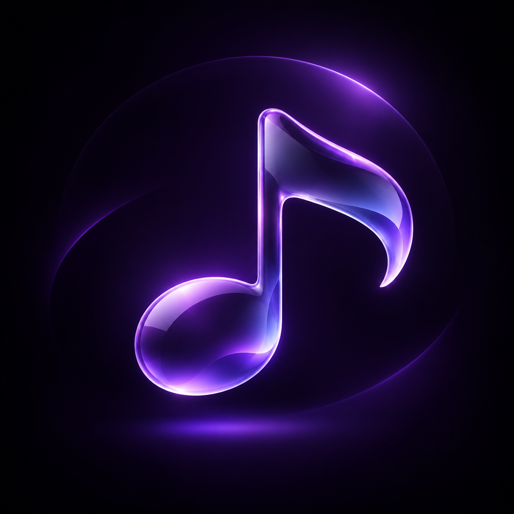

<div align="center">
  
  <h1>Auralis Player</h1>
  <p><strong>Music. Nothing extra.</strong></p>
  <p>A local-first Android music player with a Liquid Glass interface, background playback and a 10-point equalizer.</p>
  <p>
    
    
    
    
    
  </p>
  <p><a href="README.md">Русская версия</a></p>
</div>

---

## About

**Auralis Player** is an Android audio player for music stored on the device. It is designed around a simple idea: your music library should remain yours, while playback should feel polished, fast and easy to control.

Auralis reads local audio through Android MediaStore and uses a dedicated playback service so audio can continue while the app is in the background or the screen is locked.

The visual identity combines a deep dark canvas, plum and violet glow, translucent glass-like surfaces, large album artwork and a vinyl-inspired player screen.

## Features

- **Local library:** browse Tracks, Folders, Albums and Favorites.
- **Search:** filter by track title, artist, album or file location.
- **Playback:** Media3 ExoPlayer, Play/Pause, Stop, next/previous, seeking, shuffle and repeat.
- **Background playback:** MediaSessionService and Android media controls for notifications, lock screen and compatible Bluetooth headsets.
- **Artwork:** display album art when available from the media library.
- **Sleep timer:** stop playback after a selected interval.
- **10-point EQ UI:** 31 Hz to 16 kHz with Flat, Bass, Ultra Bass, Hip-Hop, Rock, Jazz, Pop, Classical, Vocal, Electronic and Acoustic presets.
- **Liquid Glass UI:** translucent surfaces, violet highlights, animated vinyl-inspired artwork and a floating navigation dock.

> The EQ exposes ten user controls, then maps them to the bands provided by the device's Android audio effect. Actual band count and availability depend on the device firmware; some emulators do not expose a system Equalizer.

## Tech Stack

| Area | Technology |
|---|---|
| Language | Kotlin |
| UI | Jetpack Compose, Material 3 |
| Playback | AndroidX Media3 ExoPlayer |
| Background media | MediaSessionService |
| Local library | Android MediaStore |
| Equalizer | Android AudioEffect / Equalizer |
| Async work | Kotlin Coroutines |
| Settings | SharedPreferences |
| Min Android | API 24 (Android 7.0) |
| Compile / Target SDK | 36 |
| JVM | 17 |

## Getting Started

### Requirements

- Android Studio compatible with Android Gradle Plugin 8.13.x.
- JDK 17.
- Android SDK Platform 36 and the corresponding Build Tools.
- Internet access for the first Gradle sync to download Gradle and dependencies.

### Open in Android Studio

1. Clone this repository or download the ZIP.
2. Open the `AuralisPlayer` directory — the one containing `settings.gradle.kts` — in Android Studio.
3. Wait for Gradle Sync to finish.
4. Connect an Android device with USB debugging enabled or start an emulator.
5. Press **Run**.
6. Grant access to local audio when prompted. Notification permission is requested separately on Android versions that require it.

### Build from the command line

Windows PowerShell:

```powershell
.\gradlew.bat assembleDebug
```

macOS / Linux:

```bash
chmod +x ./gradlew
./gradlew assembleDebug
```

The Debug APK is generated under `app/build/outputs/apk/debug/`.

For a Release build:

```bash
./gradlew assembleRelease
```

Release enables R8 and resource shrinking. Sign the APK/AAB with your own release key before distributing it. Never commit keystores or passwords.

> This repository includes a small Gradle bootstrap script (`gradlew` / `gradlew.bat`) that downloads Gradle 8.13 on first use. It is not the binary `gradle-wrapper.jar`.

## Android Permissions

The app declares permissions for local audio access and playback:

- `READ_MEDIA_AUDIO` on Android 13+.
- `READ_EXTERNAL_STORAGE` on older Android versions (up to API 32).
- `POST_NOTIFICATIONS` where required.
- `FOREGROUND_SERVICE` and `FOREGROUND_SERVICE_MEDIA_PLAYBACK`.
- `WAKE_LOCK` and `MODIFY_AUDIO_SETTINGS`.

The current manifest does **not** request the `INTERNET` permission. Core playback is local and does not require an account or cloud service.

## Project Status

Current source version: **1.2.0**. The project is under active development. Behavior may vary with Android version, device manufacturer and available audio effects.

Before publishing a release, verify Gradle Sync, Debug/Release builds, media permissions, library scanning, notifications, Bluetooth playback and EQ on a physical device. No APK is included in this repository.

## Contributing

Bug reports and improvement ideas are welcome. Please check existing Issues before opening a new one and read [CONTRIBUTING.md](CONTRIBUTING.md) before submitting code changes.

## Author

**DaimonXX**

## License

Auralis Player is distributed under the [MIT License](LICENSE).
