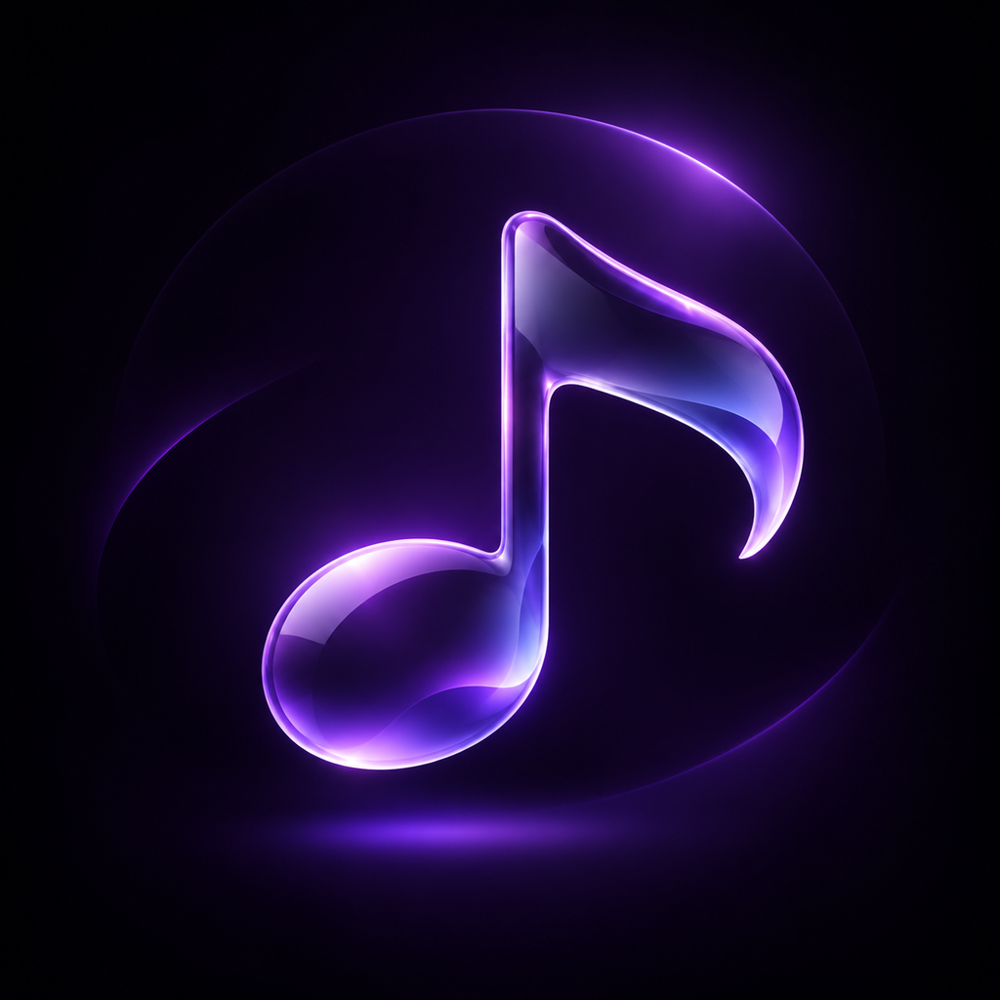

<div align="center">
  
  <h1>Auralis Player</h1>
  <p><strong>Музыка. Без лишнего.</strong></p>
  <p>Локальный Android-плеер с выразительным Liquid Glass-интерфейсом, фоновой музыкой и эквалайзером.</p>
  <p>
    
    
    
    
    
    
  </p>
</div>

---

## О проекте

**Auralis Player** — Android-аудиоплеер для прослушивания музыки, которая уже хранится на устройстве. Приложение строится вокруг простой идеи: личная музыкальная коллекция должна оставаться личной, а управление ею — быстрым, красивым и понятным.

Вместо музыкального стриминга, регистрации и облачной библиотеки Auralis работает с локальными аудиофайлами. Медиатека собирается из доступных Android источников, а воспроизведение вынесено в отдельный сервис, чтобы музыка могла продолжать играть, когда пользователь свернул приложение или заблокировал экран.

Визуальный язык проекта — **Liquid Glass**: глубокий чёрный фон, сливово-фиолетовое свечение, полупрозрачные стеклянные поверхности, крупная обложка и виниловая композиция на экране воспроизведения.

## Возможности

### Музыкальная библиотека

- Сканирование локальных аудиофайлов через Android `MediaStore`.
- Разделы **Треки**, **Папки**, **Альбомы** и **Избранное**.
- Поиск по названию композиции, исполнителю, альбому и расположению файла.
- Отображение длительности, исполнителя, альбома и доступной обложки.
- Запуск отдельной композиции или очереди из библиотеки.

### Воспроизведение

- Воспроизведение локальных файлов через Media3 ExoPlayer.
- Play/Pause, Stop, следующий и предыдущий трек.
- Перемотка и отображение прошедшего/оставшегося времени.
- Перемешивание и режимы повтора.
- Отдельный сервис воспроизведения и MediaSession для системных медиаконтролов.
- Поддержка системного уведомления, экрана блокировки и совместимых Bluetooth-гарнитур.
- Автоматическая реакция на отключение наушников.
- Таймер сна.

### Эквалайзер

- Десять визуальных диапазонов от **31 Гц до 16 кГц**.
- Ручная регулировка усиления.
- Предустановки Flat, Bass, Ultra Bass, Hip-Hop, Rock, Jazz, Pop, Classical, Vocal, Electronic и Acoustic.
- Сохранение выбранного профиля и состояния эквалайзера.
- Передача профиля в фоновый сервис и применение через Android `Equalizer`.

> Важно: интерфейс предоставляет десять контрольных точек, но реальное количество полос системного эффекта зависит от аудиодвижка и прошивки устройства. На отдельных эмуляторах аппаратный/системный Equalizer может быть недоступен.

### Дизайн

- Liquid Glass-панели и мягкие фиолетовые свечения.
- Тёмная цветовая система.
- Крупная обложка и виниловая визуализация текущего трека.
- Округлая системная типографика без добавления тяжёлых файлов шрифтов.
- Мини-плеер и плавающая нижняя навигация.

## Технологии

| Компонент | Технология |
|---|---|
| Язык | Kotlin |
| UI | Jetpack Compose + Material 3 |
| Проигрыватель | AndroidX Media3 ExoPlayer |
| Фоновое воспроизведение | MediaSessionService |
| Библиотека аудио | Android MediaStore |
| Эквалайзер | Android `AudioEffect` / `Equalizer` |
| Асинхронность | Kotlin Coroutines |
| Сохранение настроек | SharedPreferences |
| Минимальная версия Android | API 24 (Android 7.0) |
| Целевая версия SDK | API 36 |
| JVM | 17 |

## Запуск проекта

### Требования

- Android Studio с поддержкой Android Gradle Plugin 8.13.x.
- JDK 17 (в Android Studio: **Settings → Build, Execution, Deployment → Build Tools → Gradle → Gradle JDK**).
- Android SDK Platform 36 и подходящие Build Tools.
- Интернет при первой синхронизации для загрузки Gradle и зависимостей.

### Открыть в Android Studio

1. Склонируйте репозиторий или скачайте ZIP.
2. В Android Studio выберите **File → Open** и укажите папку `AuralisPlayer` — ту, в которой находится `settings.gradle.kts`.
3. Дождитесь Gradle Sync.
4. Подключите Android-устройство с включённой USB-отладкой или запустите эмулятор.
5. Нажмите **Run**.
6. При первом запуске предоставьте доступ к аудиофайлам. Разрешение на уведомления запрашивается отдельно там, где это требуется Android.

### Сборка из терминала

Windows PowerShell:

```powershell
.\gradlew.bat assembleDebug
```

macOS / Linux:

```bash
chmod +x ./gradlew
./gradlew assembleDebug
```

APK Debug появится в `app/build/outputs/apk/debug/`.

Для Release:

```bash
./gradlew assembleRelease
```

Release-вариант использует R8 и удаление неиспользуемых ресурсов. Перед распространением APK/AAB подпишите сборку собственным ключом. Не добавляйте keystore и пароли в Git.

> В репозитории используется небольшой bootstrap-скрипт `gradlew` / `gradlew.bat`, который скачивает Gradle 8.13 при первом запуске. Это не бинарный `gradle-wrapper.jar`; Android Studio также может выполнять синхронизацию через установленный Gradle.

## Разрешения Android

Приложение использует разрешения, необходимые для локальной медиатеки и фонового воспроизведения:

- `READ_MEDIA_AUDIO` на Android 13 и новее.
- `READ_EXTERNAL_STORAGE` на старых версиях Android (ограничено API 32).
- `POST_NOTIFICATIONS` для системных уведомлений там, где это требуется.
- `FOREGROUND_SERVICE` и `FOREGROUND_SERVICE_MEDIA_PLAYBACK` для длительного воспроизведения.
- `WAKE_LOCK` и `MODIFY_AUDIO_SETTINGS` для аудиосценариев.

В текущем `AndroidManifest.xml` не запрашивается разрешение `INTERNET`: приложение предназначено для локального воспроизведения и не использует сетевую библиотеку.

## Структура проекта

```text
AuralisPlayer/
├── app/
│   ├── src/main/
│   │   ├── java/com/daimonxx/auralis/
│   │   │   ├── MainActivity.kt
│   │   │   ├── data/
│   │   │   │   ├── AudioTrack.kt
│   │   │   │   └── AudioRepository.kt
│   │   │   ├── playback/
│   │   │   │   ├── PlaybackService.kt
│   │   │   │   └── AuralisEqualizer.kt
│   │   │   └── ui/
│   │   │       ├── AuralisApp.kt
│   │   │       ├── EqualizerScreen.kt
│   │   │       ├── components/
│   │   │       └── theme/
│   │   ├── res/
│   │   └── AndroidManifest.xml
│   └── build.gradle.kts
├── assets/
│   ├── auralis-avatar.png
│   └── auralis-social-preview.png
├── gradle/
├── .github/
├── README.md
├── README.en.md
├── LICENSE
└── settings.gradle.kts
```

## Изображения бренда

- `assets/auralis-avatar.png` — квадратная аватарка Auralis с минималистичной стеклянной нотой. Её можно использовать в README, профиле разработчика или организации GitHub.
- `assets/auralis-social-preview.png` — широкая картинка для **Settings → General → Social preview** репозитория.

## Статус проекта

Текущая версия исходников — **1.2.0**. Проект находится в разработке. Сборка и поведение могут отличаться в зависимости от установленной версии Android, производителя устройства и доступных системных аудиоэффектов.

Перед публикацией релиза рекомендуется проверить Gradle Sync, Debug/Release-сборку, выдачу разрешений, чтение библиотеки, работу уведомления, Bluetooth и эквалайзера на физическом устройстве. APK в этом репозитории не прилагается.

## Участие в разработке

Идеи и сообщения об ошибках приветствуются. Перед созданием Issue проверьте, нет ли уже похожего обсуждения. Для изменений кода см. [CONTRIBUTING.md](CONTRIBUTING.md).

## Автор

**DaimonXX** — автор проекта Auralis Player.

## Лицензия

Код распространяется по лицензии [MIT](LICENSE). Она разрешает использовать, изменять и распространять проект при сохранении уведомления об авторских правах и текста лицензии.
